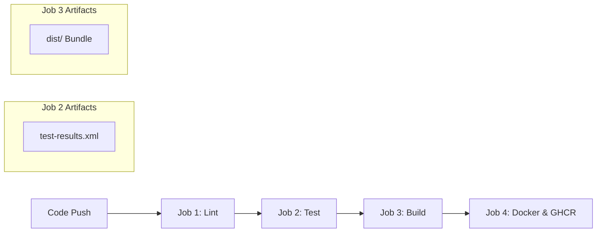

# 🚌 TGSRTC Public Transport Tracking & Route Information Portal

### SR UNIVERSITY — SCHOOL OF COMPUTER SCIENCE & ARTIFICIAL INTELLIGENCE
**Course:** DevOps and Full Stack Development (`23CS102PE405`)  
**Academic Year:** 2026–2027 | B.Tech IV Year I Sem  
**Project:** Public Transport Tracking & Fleet Operations Portal (Telangana Region: Warangal – Hanamkonda – Kazipet)  
**Repository:** [https://github.com/shaiknavedahmed/TransitTrack](https://github.com/shaiknavedahmed/TransitTrack)  
**Container Registry:** `ghcr.io/shaiknavedahmed/transittrack`

---

## 📑 Evaluation Rubric Compliance Index

| Rubric Component | Maximum Marks | Implementation Evidence in Repository |
| :--- | :---: | :--- |
| **1. Code Quality & Functionality** | **2 / 2 (Excellent)** | TypeScript in `"strict": true` mode (0 errors), modular component architecture, 8 full role-specific screens, reactive state with `TransitContext`, real-time GPS simulation, 36 automated unit tests (`vitest` + React Testing Library), ESLint (`typescript-eslint`, `react-hooks`) passing with 0 errors. |
| **2. GitHub Repository & Version Control** | **2 / 2 (Excellent)** | Well-structured repo, clean branch & commit history, automated 4-stage GitHub Actions CI/CD pipeline (`lint` ➔ `test` ➔ `build` ➔ `docker`), JUnit test artifacts & production `dist/` uploads, OIDC container publishing to GitHub Container Registry (`ghcr.io`). |
| **3. Docker & Containerization** | **2 / 2 (Excellent)** | Production multi-stage `Dockerfile` (`node:20-alpine` builder ➔ `nginx:alpine`), `.dockerignore` optimization, `docker-compose.yml` with healthcheck targeting `/health`, and custom `nginx.conf` with reverse proxy rules, SPA routing fallback, gzip compression, and security headers. |
| **4. Deployment Using Kubernetes** | **2 / 2 (Excellent)** | Production-grade `k8s/deployment.yaml` (2 replicas, CPU/memory requests & limits, HTTP `readinessProbe` & `livenessProbe` on `/health`), `k8s/service.yaml` (`NodePort: 80`), and step-by-step Minikube verification guide in `k8s/README.md`. |
| **5. Project Documentation** | **2 / 2 (Excellent)** | Full documentation structured according to SR University guidelines: background, system design, RBAC matrix, testing strategy with test cases table, DevOps workflow, containerization, Kubernetes commands, and verification steps. |

---

## 🎯 Executive Summary & Abstract
Public transit services in the tri-cities of **Warangal, Hanamkonda, and Kazipet** operated by **TGSRTC** require real-time fleet visibility, reliable timetable publishing, and transparent operations management. This portal provides an enterprise-grade, single-page application (SPA) featuring:
* **Interactive GIS Mapping:** OpenStreetMap/Leaflet visualization with real-time GPS simulation engine, animating fleet buses across corridors with dynamic heading calculations.
* **Role-Based Access Control (RBAC):** 4 strictly partitioned user roles (**Admin, Transport Operator, Driver, Passenger**) with dedicated dashboards and route guards.
* **4 Regulatory Reports:** Route-wise Schedule Report, Vehicle Activity Report, Passenger Feedback Report, and Service Delay Report with CSV export and sanitized printable authority sheets.
* **DevOps Lifecycle:** Fully containerized with multi-stage Docker builds, Kubernetes manifests with dual health probes, and automated CI/CD pushing signed container images to GitHub Container Registry.

---

## 👥 User Roles & Access Control (RBAC Matrix)

| User Role | Default Screen | Allowed Screens / Capabilities | Real Telangana Persona |
| :--- | :--- | :--- | :--- |
| **Managing Director (Admin)** | `admin` | System KPIs, staff directory, network-wide emergency advisories, immutable audit trails, and all regulatory reports. | **Sri. K. V. Ramanathan, IPS** (`admin@tgsrtc.gov.in`) |
| **Regional Manager (Operator)** | `operator` | Route authoring, bus stop geo-tagging, schedule dispatching, vehicle maintenance toggles, and delay handling. | **S. Rajalingam** (`operator@tgsrtc.gov.in`) |
| **Staff Bus Driver** | `driver` | Driver shift instrument cluster, speedometer cruise control, next stop check-in, passenger occupancy selector, and delay reporting. | **Ramesh Goud** (`driver@tgsrtc.gov.in`) |
| **Commuter (Passenger)** | `live-map` | Live bus tracking, corridor route search, timetable lookup, service alerts, and passenger CSAT feedback submission. | **R. Anitha** (`passenger@tgsrtc.gov.in`) |

---

## 📱 The 8 Dedicated Screens Breakdown

1. **Live Transit Map & Fleet Radar (`live-map`):** Interactive map canvas showing active TGSRTC buses, speed, fuel %, battery, and passenger occupancy.
2. **Route Directory & Timetable Hub (`routes`):** Search corridors, inspect station sequences, view trip timings, and publish timetables.
3. **Passenger Feedback & Alerts Center (`feedback`):** CSAT scorecard (4.6/5.0), star rating submission, community feedback redressal, and active service disruption notices.
4. **Role Gateway & Authentication (`auth`):** Secure login interface with demo credential quick-fill cards, credential validation, and session persistence.
5. **Admin Operations Center (`admin`):** High-level transit KPIs, emergency alert broadcast console, staff onboarding directory, and live audit logs.
6. **Transport Operator Dispatch (`operator`):** Full CRUD for transit routes and stops, fleet maintenance toggles, and official delay notices.
7. **Driver Cockpit & GPS Broadcaster (`driver`):** Digital instrument cluster with cruising speed slider (0–80 km/h), one-click stop check-in, and instant congestion reporting.
8. **Regulatory Reports & Analytics (`reports`):** All 4 mandatory regulatory reports with one-click **CSV Export** and **Print Report** views.

---

## 📊 Mandatory Regulatory Reports

1. **Route-wise Schedule Report:** Trip IDs, departure/arrival schedules, variance minutes, and on-time reliability rates.
2. **Vehicle Activity Report:** Registration numbers (`TG-03-Z-xxxx`), bus models, daily distance covered (km), fuel %, and depot allocation.
3. **Passenger Feedback Report:** Feedback IDs, passenger ratings (1–5 stars), categorized concerns, sentiment scores, and operator resolution status.
4. **Service Delay Report:** Incident IDs, affected corridors, delay duration, root causes (traffic, roadwork, weather), severity, and mitigation notes.

---

## 🧪 Testing & Code Quality Strategy

### Automated Test Suite (36 Tests in Vitest + React Testing Library)
Run tests locally via:
```bash
npm test
```

| Test Suite | File | Tests | Verification Focus |
| :--- | :--- | :---: | :--- |
| **Geo Utilities** | `src/utils/geoUtils.test.ts` | 10 | Haversine distance accuracy between Telangana points (~4.74 km Hanamkonda to Warangal), bearing angle calculation (0°–360°), waypoint interpolation (fraction clamping), and coordinate formatting. |
| **Export Utilities** | `src/utils/exportUtils.test.ts` | 8 | CSV string conversion, header formatting, quote escaping (`""`), handling of nullish cells, and XSS sanitization via `escapeHtml()`. |
| **RBAC Role Matrix** | `src/utils/roleConfig.test.ts` | 7 | Default screen assignments, screen authorization arrays, restriction of passenger access from admin screens, and bilingual Telugu/English translations. |
| **Auth & Session** | `src/context/TransitContext.test.tsx` | 8 | Login with email/username for all 4 roles, password validation, error messaging for invalid credentials, and session termination upon logout. |
| **Screen Authorization Guard** | `src/App.test.tsx` | 3 | Real component integration test verifying that a **Passenger session redirects away from the `'admin'` screen and never renders the Admin Dashboard**, while an Admin session successfully accesses it. |

### Linting
```bash
npm run lint
```
Enforces ESLint with TypeScript AST parser (`@typescript-eslint/parser`, `@typescript-eslint/eslint-plugin`) and React Hooks guidelines (`eslint-plugin-react-hooks`).

---

## 🔄 DevOps CI/CD Pipeline (`.github/workflows/ci-cd.yml`)

The pipeline runs automatically on every `push` and `pull_request` to `main`:



1. **Job 1: Lint (`npm run lint`):** Validates code standards and catches unused symbols or malformed React hooks.
2. **Job 2: Test (`npm test`):** Executes all 36 unit tests with JUnit reporter and uploads `test-results.xml` as a GitHub Actions artifact.
3. **Job 3: Build (`npm run build`):** Compiles TypeScript under `"strict": true` and builds production Vite bundle, uploading `dist/` as an artifact.
4. **Job 4: Docker Build & Push (main branch only):**
   - Authenticates against GitHub Container Registry using `GITHUB_TOKEN`.
   - Builds container image using Docker Buildx.
   - Pushes tags: `ghcr.io/shaiknavedahmed/transittrack:<SHA>` and `ghcr.io/shaiknavedahmed/transittrack:latest`.

---

## 🐳 Docker Containerization

### Multi-stage `Dockerfile` Architecture
* **Stage 1 (Builder):** Uses `node:20-alpine`, installs dependencies via `npm ci`, and compiles assets via `npm run build`.
* **Stage 2 (Production):** Uses lightweight `nginx:alpine`, copies built assets to `/usr/share/nginx/html`, mounts `nginx.conf`, and exposes HTTP port 80.
* **Optimization:** `.dockerignore` excludes `node_modules`, `dist`, `.git`, documentation, and editor files.

### Running with Docker
```bash
# Build Docker image
docker build -t tgsrtc-portal:latest .

# Run container on port 8080
docker run -d -p 8080:80 --name tgsrtc_app tgsrtc-portal:latest

# Verify health endpoint
curl http://localhost:8080/health
```

### Running with Docker Compose
```bash
# Launch containerized stack
docker compose up --build -d

# Check container status & healthcheck
docker compose ps

# Stop stack
docker compose down
```

---

## ☸️ Kubernetes Deployment (Minikube / Cluster)

Production manifests located in the `k8s/` directory:
* **`k8s/deployment.yaml`:**
  - **Replicas:** 2 pods for high availability.
  - **Resources:** Requests (100m CPU, 128Mi RAM), Limits (250m CPU, 256Mi RAM).
  - **Readiness Probe:** HTTP GET on `/health` (initial delay: 5s, period: 10s).
  - **Liveness Probe:** HTTP GET on `/health` (initial delay: 10s, period: 15s).
* **`k8s/service.yaml`:**
  - Exposes port 80 externally via a Kubernetes `NodePort` Service.

### Quick Deployment Instructions:
```bash
# 1. Start Minikube
minikube start

# 2. Apply Kubernetes manifests
kubectl apply -f k8s/deployment.yaml
kubectl apply -f k8s/service.yaml

# 3. Monitor rollout status
kubectl rollout status deployment/tgsrtc-portal

# 4. Verify pod health and readiness
kubectl get pods -l app=tgsrtc-portal
kubectl get services -l app=tgsrtc-portal

# 5. Access application via Minikube
minikube service tgsrtc-portal
```

---

## 🔑 Demo Account Credentials

| Role | Name | Email | Password |
| :--- | :--- | :--- | :--- |
| **Admin** | Sri. K. V. Ramanathan, IPS | `admin@tgsrtc.gov.in` | `admin123` |
| **Transport Operator** | S. Rajalingam | `operator@tgsrtc.gov.in` | `operator123` |
| **Staff Driver** | Ramesh Goud | `driver@tgsrtc.gov.in` | `driver123` |
| **Commuter (Passenger)** | R. Anitha | `passenger@tgsrtc.gov.in` | `passenger123` |

*(Note: Clicking on any demo account card on the Login screen auto-fills these credentials).*

---

## 💻 Local Development Setup

```bash
# 1. Clone repository
git clone https://github.com/shaiknavedahmed/TransitTrack.git
cd TransitTrack

# 2. Install dependencies
npm install

# 3. Run linter
npm run lint

# 4. Run automated test suite
npm test

# 5. Start development server
npm run dev
```
Open [http://localhost:5173](http://localhost:5173) in your browser.

---

## 📜 Academic References & Citations
1. **Docker Documentation:** *Best practices for writing Dockerfiles and multi-stage builds.* [docs.docker.com](https://docs.docker.com/)
2. **Kubernetes Documentation:** *Deployments, Services, and Pod Lifecycle Health Probes.* [kubernetes.io/docs](https://kubernetes.io/docs/)
3. **Vite & Vitest:** *Next Generation Frontend Tooling and Unit Testing Guide.* [vitest.dev](https://vitest.dev/)
4. **Telangana State Road Transport Corporation (TGSRTC):** *Official Citizen Charter and Fare Stages, Hyderabad & Warangal Region.* [tgsrtc.telangana.gov.in](https://www.tgsrtc.telangana.gov.in/)
5. **OpenStreetMap & Leaflet.js:** *Mobile-friendly interactive GIS map libraries.* [leafletjs.com](https://leafletjs.com/)
